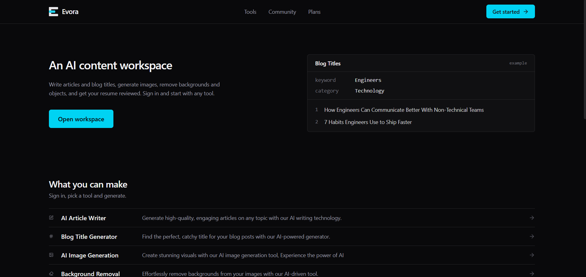
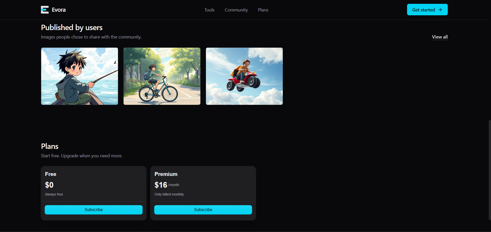
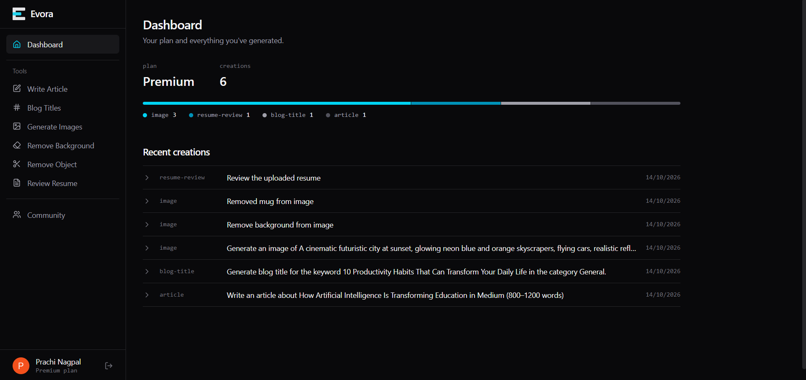
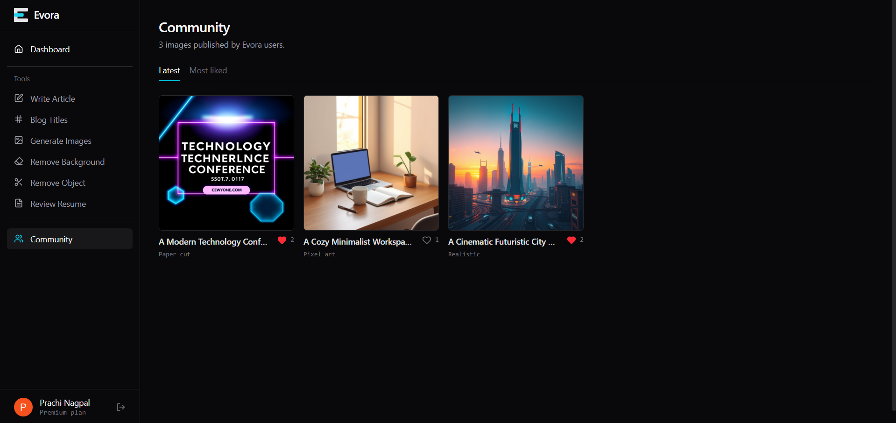
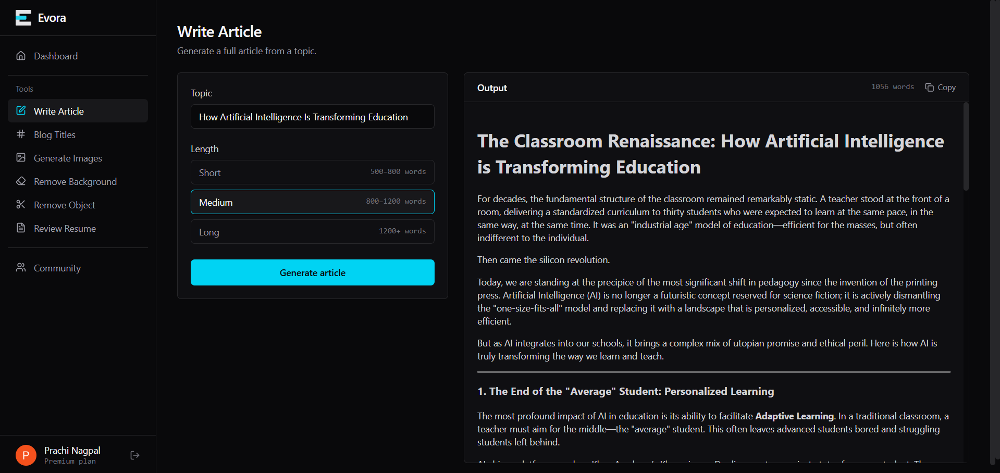
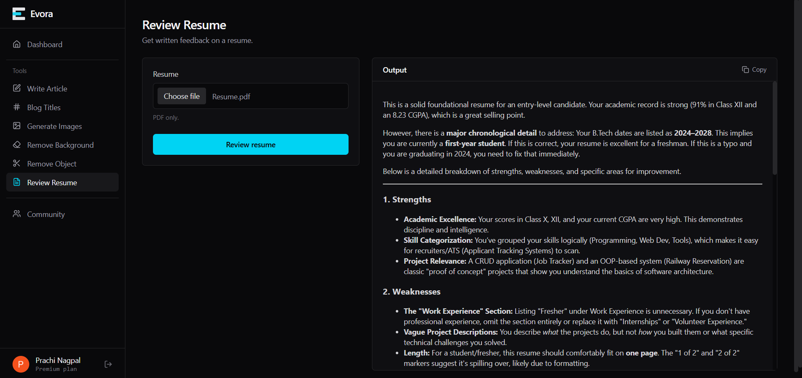
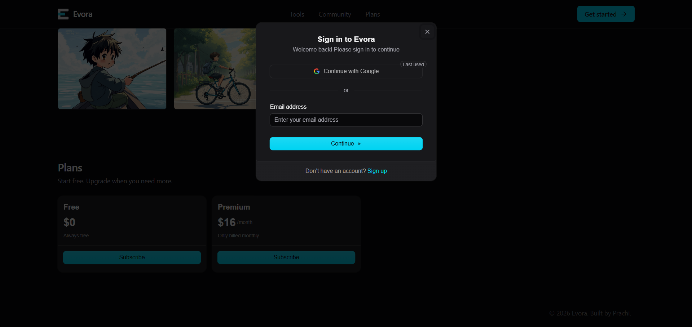
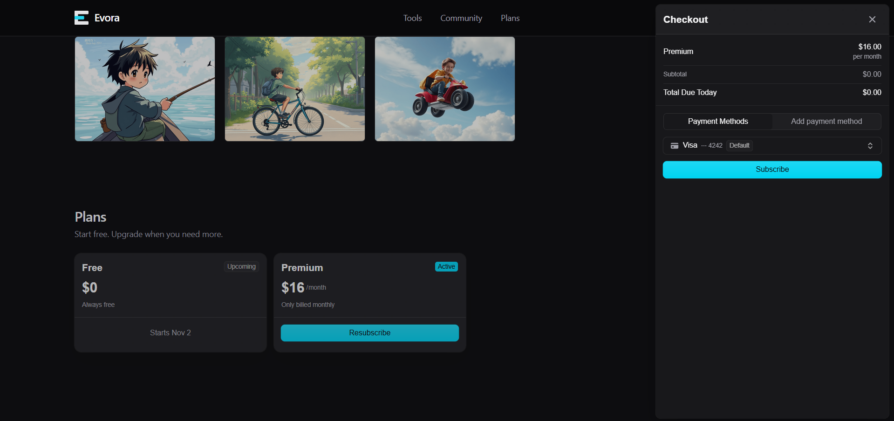

# Evora — AI Content Creation Platform

Evora is a full-stack web application that brings a set of AI content tools into one workspace: write articles, generate blog titles, create images, remove backgrounds, remove objects from photos, and get your resume reviewed. Every creation is saved to a personal dashboard, and generated images can be published to a public community feed.

<p align="center">
  
  
</p>

---

## Features

### AI tools

| Tool | What it does |
| --- | --- |
| **Article Writer** | Generates a full article from a topic and a chosen length |
| **Blog Title Generator** | Suggests titles for a given keyword and category |
| **Image Generation** | Creates images from a text prompt, with the option to publish them |
| **Background Removal** | Removes the background from an uploaded image |
| **Object Removal** | Removes a described object from an uploaded image |
| **Resume Review** | Reads an uploaded PDF resume and returns structured feedback |

### Platform

- **Authentication and subscriptions** handled by Clerk (sign-in, sessions, plan-based access)
- **Dashboard** showing your full creation history and usage
- **Community** page where users can publish generated images and like images shared by others
- **Usage limits** by plan: free users get a limited number of generations, premium users get unrestricted access

---

## Tech Stack

**Frontend**
- React 19, React Router 7
- Tailwind CSS 4 (via `@tailwindcss/vite`)
- Clerk (`@clerk/clerk-react`, `@clerk/themes`)
- Axios, React Hot Toast, React Markdown, Lucide React

**Backend**
- Node.js, Express 5
- Clerk (`@clerk/express`) for auth and plan checks
- Neon serverless PostgreSQL (`@neondatabase/serverless`)
- Gemini API through the OpenAI SDK (`openai`)
- Cloudinary for image storage and transformations
- Multer for file uploads, `pdf-parse` for reading resumes
- Axios, `form-data`, CORS, dotenv

---

## Architecture

```
┌─────────────────┐      ┌──────────────────┐      ┌────────────────┐
│  React client   │ ───▶ │  Express server  │ ───▶ │  Gemini API    │
│  (Vite, Clerk)  │ ◀─── │  (Clerk auth)    │ ───▶ │  Cloudinary    │
└─────────────────┘      └────────┬─────────┘      └────────────────┘
                                  │
                                  ▼
                         Neon PostgreSQL
                    (creations, likes, history)
```

1. The client authenticates with Clerk and sends the session token with each request.
2. The server verifies the token, checks the user's plan and usage, then calls the AI provider.
3. Results are stored in PostgreSQL (images are uploaded to Cloudinary first) and returned to the client.

---

## Getting Started

### Prerequisites

- Node.js 20 or later
- A [Clerk](https://clerk.com) application
- A [Neon](https://neon.tech) PostgreSQL database
- A [Cloudinary](https://cloudinary.com) account
- A Gemini API key

### 1. Clone the repository

```bash
git clone https://github.com/prachinagpal7/Evora.git
cd Evora
```

### 2. Set up the database

Run this once in your Neon SQL editor:

```sql
CREATE TABLE creations (
  id SERIAL PRIMARY KEY,
  user_id TEXT NOT NULL,
  prompt TEXT NOT NULL,
  content TEXT NOT NULL,
  type TEXT NOT NULL,
  publish BOOLEAN DEFAULT FALSE,
  likes TEXT[] DEFAULT '{}',
  created_at TIMESTAMP WITH TIME ZONE DEFAULT now(),
  updated_at TIMESTAMP WITH TIME ZONE DEFAULT now()
);
```

### 3. Set up the server

```bash
cd server
npm install
```

Create `server/.env`:

```env
PORT=3000
DATABASE_URL=your_neon_connection_string
GEMINI_API_KEY=your_gemini_api_key
CLIPDROP_API_KEY=your_clipdrop_api_key
CLERK_PUBLISHABLE_KEY=your_clerk_publishable_key
CLERK_SECRET_KEY=your_clerk_secret_key
CLOUDINARY_CLOUD_NAME=your_cloud_name
CLOUDINARY_API_KEY=your_cloudinary_api_key
CLOUDINARY_API_SECRET=your_cloudinary_api_secret
```

Start the server:

```bash
npm run server
```

### 4. Set up the client

In a new terminal:

```bash
cd client
npm install
```

Create `client/.env`:

```env
VITE_CLERK_PUBLISHABLE_KEY=your_clerk_publishable_key
VITE_BASE_URL=http://localhost:3000
```

Start the client:

```bash
npm run dev
```

The app runs at `http://localhost:5173`.

---

## Screenshots

<table>
  <tr>
    <td align="center" width="50%"><b>Dashboard</b><br /></td>
    <td align="center" width="50%"><b>Community</b><br /></td>
  </tr>
  <tr>
    <td align="center" width="50%"><b>Article Writer</b><br /></td>
    <td align="center" width="50%"><b>Resume Review</b><br /></td>
  </tr>
  <tr>
    <td align="center" width="50%"><b>Authentication</b><br /></td>
    <td align="center" width="50%"><b>Subscription</b><br /></td>
  </tr>
</table>

---

## Roadmap

- [ ] More AI-powered content creation tools
- [ ] Advanced search and filtering for creation history
- [ ] Additional community discovery and interaction features
- [ ] Improved usage analytics and content organization
- [ ] Expanded subscription and usage-management capabilities

---

Built by **Prachi** · [GitHub](https://github.com/prachinagpal7) · [LinkedIn](https://www.linkedin.com/in/prachi-nagpal-cse)